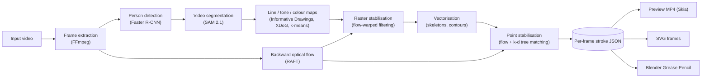

# my-local-artist

**Temporally coherent vector line art from monocular video, with export to Blender Grease Pencil.**

my-local-artist converts a video of a person into an animated drawing: clean cartoon outlines, a sketchy pencil rendering, or flat-colour rotoscoping. Every frame is represented as resolution-independent vector strokes, not pixels. The same vector data drives the preview video, an SVG sequence and a native Blender Grease Pencil animation.

The pipeline combines four steps:

- promptable video segmentation (SAM 2.1)
- learned and classical line extraction (Informative Drawings, XDoG)
- topology-aware raster-to-vector conversion
- a two-stage, motion-compensated temporal filter driven by RAFT optical flow

Everything runs locally on CUDA, Apple Silicon (MPS) or CPU. The only network access is a one-time, checksum-verified download of model weights.



## Contents

- [Quick start](#quick-start)
- [Method](#method)
  1. [Notation](#1-notation)
  2. [Subject segmentation](#2-subject-segmentation)
  3. [Line extraction](#3-line-extraction)
  4. [Raster-to-vector conversion](#4-raster-to-vector-conversion)
  5. [Drawing styles](#5-drawing-styles)
  6. [Motion estimation](#6-motion-estimation)
  7. [Temporal coherence](#7-temporal-coherence)
  8. [Rendering and export](#8-rendering-and-export)
  9. [Evaluation](#9-evaluation)
  10. [Limitations](#10-limitations)
- [Using the app](#using-the-app)
- [Performance](#performance)
- [Stroke data format](#stroke-data-format)
- [Models](#models)
- [Project layout](#project-layout)
- [Configuration](#configuration)
- [Engineering decisions](#engineering-decisions)
- [References](#references)

## Quick start

```bash
make setup     # one time: Python 3.11 venv, backend + frontend deps, model weights (~545 MB)
make dev       # backend on 127.0.0.1:8000, frontend on http://localhost:5173
```

Open http://localhost:5173.

```bash
make test      # backend test suite
make sample    # writes storage/sample_clip.mp4, a 4 s synthetic clip for testing without your own footage
```

`SKIP_MODELS=1 make setup` skips the weight download. Weights are then fetched the first time they're needed, and the UI shows the progress.

**Requirements**

- macOS or Linux
- Python 3.11. `make setup` installs it with Homebrew if it's missing, or use `PYTHON=/path/to/python3.11 make setup`.
- Node.js 18+
- FFmpeg
- Blender 4.x, only for the `.blend` export. 4.5 LTS is tested.

The compute device is chosen automatically, in the order CUDA, MPS, CPU. Override it with `DEVICE=cuda|mps|cpu`.

---

## Method

### 1. Notation

| Symbol | Meaning |
| --- | --- |
| $`I_t`$ | Input frame $`t`$ of a video with frames $`t = 0, \dots, T-1`$ |
| $`H \times W`$ | Output resolution |
| $`s = \max(H, W)/720`$ | Scale factor. Every pixel-valued constant below is tuned at 720 px and multiplied by $`s`$. |
| $`\lambda`$ | The *Smoothing* control, in $`[0, 1]`$ |
| $`\delta`$ | The *Detail* control, in $`[0, 1]`$ |
| $`\tau`$ | The *Thickness* control |
| $`\mathrm{lerp}(a, b, x) = a + (b - a)\,x`$ | Linear interpolation; controls map to parameters through it |

The output for each frame is a vector frame $`\mathcal{S}_t = (\mathcal{R}_t, \mathcal{P}_t)`$:

- **Regions** $`\mathcal{R}_t`$: filled polygons with holes.
- **Strokes** $`\mathcal{P}_t`$: polylines whose points carry a position, a width $`w_i`$ and an opacity $`\alpha_i`$.

### 2. Subject segmentation

**Initialisation by detection.** A Faster R-CNN detector [4] with a MobileNetV3-Large backbone [5] and a feature pyramid [6], trained on COCO [7], finds people in the frame the user is looking at. Detections of class *person* with confidence ≥ 0.6 are kept. The box with the largest area becomes the default prompt. If nobody is detected, a positive point at the frame centre is used instead.

**Interactive refinement.** User clicks are passed to SAM 2.1 as positive or negative point prompts.

- A single point is ambiguous: a click on a shirt could mean the shirt or the whole person. If the first positive click falls inside a detected person box, the smallest such box is added to the prompt, which resolves the ambiguity towards the whole person.
- For a single click with no box, SAM is asked for three candidate masks, and the one with the highest predicted IoU is kept.

**Video propagation.** SAM 2 [1] extends the Segment Anything model [2] to video with a streaming memory.

- A hierarchical ViT image encoder (Hiera [3]) embeds each frame.
- *Memory attention* conditions the current frame's features on a bank of encoded masks from previous frames and from the prompted frame.
- A memory encoder writes each new prediction back into the bank.

Masks are propagated forward and backward from the prompted frame index $`t_0`$. Backward propagation reuses the forward predictor on a reversed frame order.

The predictor keeps every frame it has loaded, at 1024² resolution in float32, so memory grows linearly with clip length. To keep memory bounded, propagation runs in chunks:

- Chunks are 150 frames, or 60 in low-memory mode.
- Consecutive chunks overlap by one frame.
- Each chunk is seeded with the mask that the previous chunk predicted for that shared frame.

Peak memory is therefore $`O(\text{chunk})`$ instead of $`O(T)`$. Inference runs under float16 autocast on MPS and bfloat16 on CUDA. On MPS this was 1.7× faster than float32, with identical masks in testing.

**Mask post-processing.** Each mask $`M_t`$ is cleaned in two steps:

1. Connected components (8-connectivity) smaller than $`\max(0.02\,A_{\max}, 16)`$ pixels are removed, where $`A_{\max}`$ is the area of the largest component.
2. Background components (4-connectivity) smaller than 0.1% of the frame are filled.

Real gaps, such as the space between an arm and the torso, are larger than that and survive. The cleanup prevents the line tracer from outlining segmentation noise.

### 3. Line extraction

#### 3.1 Learned contours: Informative Drawings

The clean and rotoscope styles use the contour generator of Informative Drawings [8]. The method learns photo-to-line-drawing translation from unpaired data. Its training objective combines:

- an adversarial style loss
- a *geometry* loss, which requires that depth can be predicted from the drawing
- a *semantic* loss, which matches the CLIP embeddings of the drawing and the photograph

The result is a set of lines that convey 3D shape and semantics, rather than every intensity edge.

The generator is a ResNet-style encoder–decoder:

1. 7×7 convolution to 64 channels
2. two stride-2 convolutions, to 256 channels
3. three residual blocks
4. two transposed convolutions back to full resolution
5. 7×7 convolution and a sigmoid

It uses instance normalisation and reflection padding throughout. The input is padded to a multiple of 4 by edge replication. The output is inverted, so that $`L_t \in [0, 1]`$ is an *ink* map. The contour checkpoint (`model.pth`) is used rather than the second released checkpoint (`model2.pth`), which draws loose, sketchy construction lines.

When background removal is enabled, the network sees the subject composited on white, using a feathered mask:

```math
\tilde I_t = \alpha_t\, I_t + (1 - \alpha_t)\cdot 255, \qquad \alpha_t = G_{\sigma=1} * M_t .
```

The drawing therefore follows the silhouette and contains nothing from the background. Ink is also clipped to the mask dilated by $`3s`$ pixels.

#### 3.2 Classical edges: XDoG

The pencil style uses the eXtended Difference-of-Gaussians [9] on the grey image $`g \in [0, 1]`$:

```math
D = (1 + p)\, G_{\sigma} * g' \;-\; p\, G_{k\sigma} * g', \qquad
E = \begin{cases} 1 & D \ge \varepsilon \\ 1 + \tanh\!\big(\varphi\,(D - \varepsilon)\big) & D < \varepsilon \end{cases}, \qquad
L = 1 - E .
```

The parameters are:

| Parameter | Value |
| --- | --- |
| $`k`$ | 1.6 |
| $`p`$ | 30 |
| $`\varphi`$ | 20 |
| $`\sigma`$ | $`\mathrm{lerp}(1.25, 0.8, \delta)\sqrt{s}`$ |
| $`\varepsilon`$ | $`\mathrm{lerp}(0.24, 0.31, \delta)`$ |

Without any adjustment, XDoG turns uniformly dark regions (black clothing, deep shadow) into solid ink, because $`D \approx g < \varepsilon`$ there. To avoid this, grey levels are first lifted, $`g' = 0.35 + 0.65\,g`$, so flat areas stay above $`\varepsilon`$ and only genuine edges are drawn. Dark tones are rendered by hatching instead (§5.2).

### 4. Raster-to-vector conversion

#### 4.1 Centreline strokes

Line maps are converted to *centreline* strokes, single paths along the middle of each line, rather than outline polygons. A centreline gives each line one stroke, which is the representation Grease Pencil and stroke-based animation expect.

1. **Binarisation by hysteresis** [10]. A pixel is ink if $`L > \theta_{\text{lo}}`$ and it is connected to some pixel with $`L > \theta_{\text{hi}}`$, where $`\theta_{\text{lo}} = \mathrm{lerp}(0.30, 0.12, \delta)`$ and $`\theta_{\text{hi}} = \mathrm{lerp}(0.60, 0.35, \delta)`$. Compared with a single threshold, this keeps faint segments of strong lines and stops lines breaking into dashes. Components smaller than $`12 s^2`$ pixels are discarded.
2. **Thinning.** The binary map is reduced to a one-pixel-wide, 8-connected skeleton with the Zhang–Suen parallel thinning algorithm [11] (scikit-image).
3. **Graph decomposition.** Each skeleton pixel's degree is computed by convolution with the 8-neighbour kernel. Pixels of degree ≥ 3 form junction clusters. Removing them splits the skeleton into simple chains.
   - Each chain is traced from an endpoint, preferring 4-neighbours over diagonal ones so staircase corners are not skipped.
   - Chains with no endpoint are closed loops.
   - A chain end adjacent to a junction is extended to the junction cluster's centroid, so strokes still meet at T- and X-junctions.
4. **Pruning.** Chains shorter than $`\mathrm{lerp}(18, 6, \delta)\,s`$ pixels are dropped.
5. **Smoothing.** Pixel-quantised chains are smoothed with a 1D Gaussian along arc length, $`\sigma = \mathrm{lerp}(0.6, 5.0, \lambda)\,s`$ samples. Closed paths wrap around. Open paths keep their exact endpoints, so junctions stay connected.
6. **Arc-length resampling.** Points are redistributed at uniform spacing of $`2.5\,s`$ pixels by linear interpolation of the cumulative chord length. Uniform sampling makes curvature-independent point matching between frames possible (§7.3), and gives Blender evenly spaced control points.

#### 4.2 Region outlines

For the flat-colour style, a label image $`\ell(x) \in \{-1, 0, \dots, K-1\}`$ is converted to filled polygons with holes:

1. **Small-region absorption.** Connected components of each label smaller than $`A_{\min} = \mathrm{lerp}(700, 90, \delta)\,s^2`$ are relabelled to the label of their nearest large-region pixel, using the Euclidean feature transform (`distance_transform_edt` with indices). Merging specks into their neighbours avoids the visual noise of tiny islands, and avoids leaving holes where they were.
2. **Border following.** Each label mask is dilated by one pixel, so adjacent fills overlap slightly and no hairline seams appear. Its contours are then extracted with Suzuki–Abe border following [12] in two-level (`RETR_CCOMP`) mode. That mode gives outer boundaries and their holes explicitly, as a parent–child hierarchy.
3. Each outer boundary and hole is Gaussian-smoothed (wrapping, $`\sigma = \mathrm{lerp}(0.8, 4.0, \lambda)\,s`$) and resampled at $`3s`$ pixels. Regions are painted largest first.

### 5. Drawing styles

Each style is split into two functions:

```math
\mathit{rasterize}: I_t \mapsto \{\text{float maps}\}, \qquad \mathit{vectorize}: \{\text{maps}\} \mapsto \mathcal{S}_t ,
```

The split lets temporal filtering act on the intermediate maps (§7.2). A third function, *prepare*, runs once per video and builds state that must stay constant over time, such as a colour palette.

#### 5.1 Clean outlines

The strokes are the centrelines of the Informative Drawings ink map (§3.1, §4.1). They are drawn at a uniform width $`2.4\,\tau s`$ pixels in a single ink colour.

#### 5.2 Sketchy pencil

The strokes are the centrelines of the XDoG map, with the following additions.

- **Width.** Each point's width comes from the line's local thickness: $`w_i = \mathrm{clip}\big(2\,\mathrm{DT}(x_i),\, s,\, 3.5 s\big) \cdot 0.75\,\tau`$. Here $`\mathrm{DT}`$ is the Euclidean distance transform of the binary edge map, sampled at the centreline.
- **Multiple passes.** Every stroke longer than $`20s`$ pixels is drawn twice. Each pass is offset along the stroke normal by a smooth, position-dependent amount, $`\pm 1.1 s`$ pixels. The two passes use different materials (`graphite`, `graphite_light`), with base opacities 0.8 and 0.45.
- **Hand-drawn gestures.**
  - Endpoints overshoot or stop short by between $`-3s`$ and $`5s`$ pixels.
  - Width tapers as $`0.35 + 0.65 \sin(\pi u)^{1/2}`$ along the normalised arc length $`u`$.
  - Pressure-modulated opacity is $`0.6 + 0.4 \sin(\pi u)^{0.6}`$.
- **Coherent randomness.** All of these random quantities are drawn from smooth *value-noise fields*, never from a per-frame random number generator. A field is a Gaussian random lattice with a cell size of $`60s`$ pixels, bicubically interpolated. A line therefore gets the same wobble wherever it appears, and the drawing does not "boil" from frame to frame. The fields are sampled in subject-relative coordinates (§7.4).
- **Hatching.** Tone is taken from luminance blurred with $`\sigma = 3s`$.
  - Two thresholds come from percentiles of the subject's own luminance: the $`\mathrm{lerp}(18, 35, \delta)`$-th percentile, capped at 0.45, and the $`\mathrm{lerp}(6, 14, \delta)`$-th, capped at 0.28. Hatching therefore adapts to exposure.
  - The resulting shadow masks are eroded with a 5×5 ellipse.
  - They are filled with parallel strokes spaced $`7s`$ pixels apart: at +45° for shadow, and additionally at −45° (cross-hatching) for deep shadow.
  - Hatch lines stop short of the shadow boundary by a noise-driven amount.
- **Paper texture.** An optional paper background is generated from three band-limited noise layers (blotches, grain, fibres). It is static, so it cannot flicker. It is raster-only, so it doesn't appear in the vector exports.

#### 5.3 Rotoscope

1. **Abstraction.** Two passes of the bilateral filter [13] ($`\sigma_{\text{colour}} = 28`$, $`\sigma_{\text{space}} = 4s`$) remove texture but keep edges.
2. **Palette (once per video).** k-means++ clustering [14] runs in CIELAB, where Euclidean distance approximates perceived colour difference.
   - The number of colours is $`K = \mathrm{round}(\mathrm{lerp}(4, 10, \delta))`$.
   - About 40,000 subject pixels are sampled from 8 frames spread across the clip.
   - The clustering uses 3 restarts and a fixed seed.
   - Centres are ordered by $`L^*`$, light to dark, so material names are deterministic.

   The palette is fixed for the whole video, so a region cannot change colour because of re-clustering.
3. **Quantisation.** Each pixel takes the label of its nearest palette centre in CIELAB, a Voronoi partition of colour space. The labels are vectorised as regions (§4.2), and the clean outlines (§5.1) are drawn on top at width $`1.8\,\tau s`$.

### 6. Motion estimation

Temporal filtering needs dense correspondences between consecutive frames. These come from RAFT [15], which:

1. builds a 4D all-pairs correlation volume between the feature maps of two frames
2. pools it into a multi-scale pyramid
3. refines a flow field iteratively with a convolutional GRU that looks up correlation features around the current estimate

The torchvision implementation runs with 12 refinement iterations, and the final iterate is kept.

- **Variants.** RAFT-Large (5.3 M parameters, trained on Chairs → Things → Sintel + KITTI + HD1K) is the default. RAFT-Small (1.0 M parameters) is used on CPU and in low-memory mode.
- **Direction.** Only *backward* flow is computed: $`F_t(x)`$ maps a pixel $`x`$ of $`I_t`$ to its location $`x + F_t(x)`$ in $`I_{t-1}`$. Every temporal filter here is causal, so this is sufficient, and the cost is half that of computing both directions.
- **Resolution.** Flow is estimated with the long side at 512 px, rounded to a multiple of 8 as RAFT requires. It is stored as float16, and on load it is bilinearly upsampled with the vectors rescaled. Flow fields are smooth, so this costs little accuracy and keeps the cache to about 0.6 MB per frame.

Backward warping brings any map from frame $`t-1`$ into frame $`t`$:

```math
\mathcal{W}_t[X](x) = X\big(x + F_t(x)\big) \quad \text{(bilinear interpolation)} .
```

**Flow confidence.** Flow is unreliable at occlusions and disocclusions, under motion blur, and where content leaves the frame. Following the occlusion-aware weighting used in video style transfer [16], each pixel gets a soft photometric confidence:

```math
c_t(x) = \mathrm{clip}\!\left(1 - \frac{\big(G_{\sigma=2} * \lvert g_t - \mathcal{W}_t[g_{t-1}] \rvert\big)(x) - 0.04}{0.08},\; 0,\; 1\right) \cdot \mathbf{1}\!\left[x + F_t(x) \in \Omega\right],
```

Here $`g`$ is the greyscale frame and $`\Omega`$ is the image domain. Confidence is 1 where the warped previous frame reproduces the current one to within about 4%, and falls to 0 at about 12%.

### 7. Temporal coherence

If every frame is stylised independently, the result shows the characteristic artefacts of per-frame stylisation:

- sub-pixel *wobble* of re-traced lines
- *blinking* of lines near the detection threshold
- *colour flipping* of pixels near a palette boundary
- *swimming* of procedural texture, when noise stays fixed to the screen while the subject moves

Each is handled by a dedicated mechanism. All of them are scaled by $`\lambda`$, are motion-compensated with $`F_t`$, and are gated by $`c_t`$, so history is never propagated through occlusions.

#### 7.1 Design principle

Every filter is *causal and recursive*: frame $`t`$ is blended only with the already-filtered frame $`t-1`$, warped into place. Memory and compute are $`O(1)`$ per frame, and processing can stream. A bidirectional filter would be somewhat smoother, but it would need forward flow too, doubling the flow cost and the cache.

#### 7.2 Raster stabilisation (before vectorisation)

Let $`X_t`$ be a map produced by *rasterize*, and $`\hat X_t`$ its filtered version.

**Continuous fields** are filtered with a motion-compensated exponential moving average. These are the pencil luminance, the rotoscope CIELAB image and the subject mask.

```math
\hat X_t = a\,c_t\,\mathcal{W}_t[\hat X_{t-1}] + (1 - a\,c_t)\,X_t ,
```

The blend factor is $`a = 0.85\lambda`$ for style maps. The mask gets a lighter $`a = 0.4\lambda`$: SAM 2 is already temporally consistent, and a lagging mask would clip fast-moving limbs. The colour image is filtered *before* quantisation, which removes palette flipping at its source.

**Ink maps** use an *evidence-gated maximum* instead:

```math
\hat L_t = L_t + c_t\Big(\max\big(L_t,\; \min(\mathcal{W}_t[\hat L_{t-1}],\; \kappa L_t)\big) - L_t\Big), \qquad \kappa = 1 + 2a .
```

This operator has three properties, each guaranteed by its form:

| Property | Guarantee | Consequence |
| --- | --- | --- |
| Never dims | $`\hat L_t \ge L_t`$ | A line detected now is never weakened, so a misaligned history can't erase it. |
| No ghosts | $`\hat L_t \le \kappa L_t`$, so $`L_t = 0 \Rightarrow \hat L_t = 0`$ | Ink can't appear where the current frame has no evidence, so there are no trails. |
| No blinking | A line seen at $`t-1`$ and only faintly at $`t`$ is boosted up to $`\kappa\times`$ | Near-threshold lines stay above the hysteresis threshold. |

A plain average was tried first and failed in exactly the case that matters. When the flow is off by one pixel on a fast-moving limb, averaging halves the line's intensity, and the line drops below threshold and vanishes.

#### 7.3 Point stabilisation (after vectorisation)

Re-tracing every frame produces a new, unrelated point sampling of each line, so positions jitter by a pixel or so. Each point $`p`$ of a stroke in $`\mathcal{S}_t`$ is processed as follows:

1. **Back-project** the point along the flow, $`q = p + F_t(p)`$.
2. **Match** it to the nearest point $`\hat p'`$ of the already-smoothed frame $`\hat{\mathcal{S}}_{t-1}`$, using a k-d tree [17] per material. Only points of the same material are candidates, so the two pencil passes match only themselves. The search radius is $`r = 3s`$ pixels at a distance $`d`$.
3. **Pull** the point towards the match carried forward:

```math
w = \beta\, c_t(p)\,\big(1 - d/r\big), \qquad \Delta p = w\,\big(\hat p' - F_t(p) - p\big), \qquad \beta = 0.9\lambda .
```

4. **Smooth** the correction field $`\Delta p`$ along the stroke with a Gaussian ($`\sigma = 2`$ samples) before applying it. This keeps a partially matched stroke from kinking at the match boundary.
5. **Blend attributes.** Width and opacity are blended with the same weight $`w`$, so pencil pressure doesn't pulse.
6. **Regions.** Outlines and holes are treated the same way.

The weight falls linearly with match distance and with flow confidence. Genuinely new or moving geometry is therefore left untouched, and the filter follows motion rather than lagging behind it.

#### 7.4 Subject-anchored procedural texture

Screen-space noise on a moving subject creates a "shower door" effect: the subject appears to slide through a fixed pattern. To avoid it, the subject's global displacement is accumulated as the median backward flow inside the mask, a robust estimate of the dominant motion:

```math
a_t = a_{t-1} - \mathrm{median}_{x \in M_t} F_t(x), \qquad a_0 = 0 .
```

The pencil noise fields are sampled at $`x - a_t`$, with toroidal wrapping, and the hatching grid is shifted by $`a_t`$ projected onto its row normal, modulo the line spacing. Wobble, overshoot and hatch lines therefore travel with the subject.

### 8. Rendering and export

All outputs are generated from the same per-frame vector JSON. This is the single source of truth: what the preview shows is what the exporters write.

- **Preview renderer (Skia).**
  - Uniform-width strokes are rendered as quadratic Bézier segments through consecutive midpoints, with each sample as a control point. This is exactly the uniform quadratic B-spline of the samples, so the curve is $`C^1`$-continuous.
  - Variable-width strokes are drawn as round-capped segments into an isolated layer with *source* blending, then composited once. Overlapping caps replace rather than accumulate, so no dark beads appear at joints.
  - Regions use the even-odd fill rule, so holes are cut.
- **SVG.**
  - Regions become even-odd paths.
  - Uniform strokes become stroked paths, using the same midpoint B-spline.
  - SVG has no per-vertex width, so each variable-width stroke becomes a filled outline polygon. The outline is the centreline offset by $`\pm w_i/2`$ along the normals, with arc caps.
  - A rasterised SVG differs from the preview by 1.4/255 mean absolute error.
- **Blender Grease Pencil.** A headless Blender script builds a native Grease Pencil object with *Fills* and *Lines* layers, one keyframe per video frame, and per-point radius and opacity. It targets the GPv3 API of Blender 4.3+, with a fallback for the legacy GPv2 API of 4.0–4.2.
  - **Geometry.** Pixels map to the XZ plane through $`(x, y) \mapsto \big(\sigma(x - W/2),\, 0,\, \sigma(H/2 - y)\big)`$, with $`\sigma = 4\,\text{m}/\max(W, H)`$. An orthographic camera with scale 4 m reproduces the video framing exactly.
  - **Holes.** Region holes are emitted as strokes with a *holdout* material, which cuts through the fill.
  - **Colour management.** The preview composites in sRGB, but Blender composites in linear light. Material colours are converted with the sRGB EOTF. For dark ink of opacity $`\alpha`$ over white, the preview shows the grey $`1 - \alpha`$. To display the same grey from linear blending, the exported opacity must be
    ```math
    \alpha_{\text{Blender}} = 1 - f_{\text{sRGB}}(1 - \alpha),
    ```
    where $`f_{\text{sRGB}}`$ is the sRGB-to-linear transfer function. This maps 0.5 to 0.786. Combined with the *Standard* view transform, this reduced the mean difference between Blender renders and the preview to 2.4/255 (pencil) and 3.4/255 (rotoscope). Stroke widths match exactly.

### 9. Evaluation

**Protocol.** Temporal stability is measured on a synthetic sequence with known ground-truth motion:

- 48 frames at 640×640 and 24 fps, made by applying a known per-frame similarity transform to a photograph (the scikit-image *astronaut* image).
- Per frame: rotation 0.15°, zoom 0.4% and translation 2 px.
- Per-pixel Gaussian sensor noise ($`\sigma = 4`$ grey levels), then H.264 compression (CRF 16).

Each output frame is rendered to premultiplied RGBA, $`C_t`$, with alpha $`A_t`$. The previous frame is warped with the *exact* inter-frame transform $`\mathcal{T}_t`$, and the mean absolute difference is measured inside a 40 px border-free interior $`\Omega'`$. The difference is normalised by mean ink coverage:

```math
\text{Flicker} = \frac{\frac{1}{T-1}\sum_{t=1}^{T-1} \mathrm{mean}_{\Omega'} \big\lvert C_t - \mathcal{T}_t[C_{t-1}] \big\rvert}{\frac{1}{T}\sum_{t=0}^{T-1} \mathrm{mean}_{\Omega} A_t} .
```

Lower is better. The normalisation matters: without it, a filter could improve the score simply by deleting lines. This metric is a warping error in the sense of Lai et al. [18], computed with ground-truth rather than estimated motion, so it is not biased towards the flow used by the method.

**Results** (lower is better; relative change versus no smoothing in parentheses):

| Style | $`\lambda = 0`$ | $`\lambda = 0.5`$ (default) | $`\lambda = 1`$ |
| --- | --- | --- | --- |
| Clean outlines | 0.222 | 0.168 (−24%) | 0.155 (−30%) |
| Sketchy pencil | 0.385 | 0.262 (−32%) | 0.236 (−39%) |
| Rotoscope | 0.0154 | 0.0127 (−18%) | 0.0114 (−26%) |

Rotoscope's absolute values are smaller because large, mostly static fills dominate its coverage. A unit test also checks the gated maximum's no-ghost and never-dims properties: a line that disappears from one frame to the next leaves no trace, and a current line is never weakened.

**Export fidelity** (mean absolute error per channel against the preview renderer, 8-bit):

| Export | Pencil | Rotoscope |
| --- | --- | --- |
| Blender 4.5 render | 2.4 | 3.4 |
| SVG (rasterised) | 1.4 (synthetic test frame) | n/a |

### 10. Limitations

- **Causal filtering.** The filters only look backwards in time. A forward–backward scheme would remove the slight lag that strong smoothing introduces after abrupt motion.
- **Photometric confidence only.** Flow confidence comes from brightness constancy. Lighting changes therefore lower confidence even where the flow is correct, which reduces smoothing there. A forward–backward consistency check would separate the two cases, at twice the flow cost.
- **Single subject.** Segmentation tracks one object. Mask identity can drift under long full occlusions, a limitation inherited from SAM 2's memory.
- **Fixed palette.** The rotoscope palette is fixed per clip, so a scene with strongly changing illumination is quantised with colours from the sampled frames.
- **SVG opacity.** SVG cannot vary opacity along a path. Each pencil stroke uses its mean opacity, so pencil SVGs come out slightly lighter than the preview.
- **GPv2 untested.** The legacy Blender 4.0–4.2 export path is implemented but has not been tested.

---

## Using the app

1. **Upload.** The video plays immediately from a local object URL while it streams to `storage/temp/`, and `ffprobe` reports resolution, fps, duration, size and codec.
   - **Use this video** turns the upload into a project.
   - **Discard** deletes it.
   - Unconfirmed uploads are deleted after 60 idle minutes.
2. **Subject and style.**
   - The largest person is selected automatically. **Click** to select something else, **Alt/⌥-click** to exclude an area, or use the slider to pick another frame.
   - The three style cards are rendered live from the vector strokes of that frame and follow the look settings.
3. **Settings.** These are collapsed by default.

   | Setting | Default | Notes |
   | --- | --- | --- |
   | Stroke thickness | 1.0× | |
   | Line detail | 50% | |
   | Smoothing | 50% | 0 disables temporal filtering and skips optical flow |
   | Remove background | on | |
   | Paper texture | on | Pencil only; preview video only |
   | Resolution | 720 px (480 on CPU) | Long side |
   | Frame rate | source (half on CPU) | Or half the source rate |
   | Start / End | whole clip (first 5 s on CPU) | |
   | Low memory mode | off | |

4. **Generate.** A background job runs seven stages: frames, masking, lines, flow, vectorise, smoothing and encoding. It shows per-stage status, an ETA that recalibrates from measured stage speeds, and **Cancel**, which takes effect within about a frame.
5. **Result.**
   - The original and stroke videos play in sync, with an optional multiply-blend overlay.
   - Downloads: **Download preview MP4**, **Download SVG frames (zip)** and **Export .blend (Grease Pencil)**.
   - **Try another style** keeps the video, the subject and the settings.
   - **Start over** deletes the project.

The URL hash (`#project=…&job=…` or `&render=…`) keeps your place across reloads.

### Disk usage and cleanup

Intermediate data is deleted as soon as it's no longer needed:

- **After every generation**, whether it finished, was cancelled or failed, the per-frame intermediates are deleted: extracted frames, SAM 2 masks, line maps and optical flow. Flow alone is about 1 GB per minute of 30 fps video.
- **What stays** is the render folder of the current project:
  ```
  render.json        style, settings, size, fps, frame count, range, time taken
  strokes/00000.json one vector frame per video frame
  preview.mp4        rendered from the JSON
  original.mp4       the source at the same range, fps and size (for side-by-side playback)
  svg_frames.zip     built on first download
  strokes.blend      built on first export
  ```
- **Start over** deletes the whole project: the uploaded video, all renders and all exports. On the result screen it asks for confirmation first, so you can download what you want to keep.
- **Abandoned projects**, where the tab was closed without Start over, are deleted after `PROJECT_TTL_HOURS` without use (6 h by default). Every request on a project counts as use. Projects with a running job are never swept.

Because intermediates are not kept, **Try another style** recomputes masks, line maps and flow. It costs the same as the first run, not the ~0.15 s/frame a cached rerun would take.

### Opening the .blend and animating with the Build modifier

1. Open `<video>-<style>-strokes.blend`. Press **Numpad 0** for the camera view, then **Space** to play. The fps, resolution and frame range are already set.
2. Select `Strokes_<style>`, open the **Modifiers** tab and choose **Add Modifier › Generate › Build**.
3. Configure the modifier:
   - **Mode:** Sequential
   - **Transition:** Grow
   - **Timing:** **Percentage Factor**. "Number of Frames" won't work here: every video frame is its own keyframe, and that timing restarts at each one, so the drawing would never finish.
4. Keyframe **Factor** from 0 at frame 1 to 1 at, say, frame 48. The drawing builds itself over two seconds while it keeps moving.
5. Optional: to build only the lines and leave the fills visible, set **Influence › Layer** to `Lines`.
6. Render with **Render › Render Animation**.

Change colours in the **Material** tab. Change overall thickness with the Lines layer's **Radius Offset** or a **Thickness** modifier.

**Finding Blender.** The `.blend` export looks for Blender in this order:

1. `BLENDER_PATH`
2. `blender` on `PATH`
3. the standard install location

If Blender is missing or older than 4.0, only the `.blend` button is disabled, with an explanation. The exporter can also be run on its own:

```bash
/Applications/Blender.app/Contents/MacOS/Blender -b --factory-startup \
  -P blender_export/build_grease_pencil.py -- \
  --strokes <render>/strokes --output out.blend --fps 24
```

## Performance

These are measured on an Apple M4 (MPS) at 720 px, in seconds per output frame.

| Stage | Time per frame | Notes |
| --- | --- | --- |
| Frame extraction | ~0.01 s | |
| SAM 2.1-S propagation | ~0.55 s | Mixed precision (0.95 s in fp32). Skipped without background removal. |
| Informative Drawings | ~0.2 s | Batches of 4; clean and rotoscope only |
| RAFT-Large flow | ~0.27 s | Skipped when Smoothing is 0 |
| Vectorisation and raster stabilisation | ~0.07 s | |
| Point stabilisation | ~0.05 s | |
| Encoding | ~0.03 s | Preview video plus the matching original |

That is about **1.2 s/frame** end to end for clean and rotoscope, and about 1 s for pencil. A 10 s, 24 fps clip takes about 5 minutes, and halving the frame rate halves the time. A single-frame style preview takes about 0.15–1.2 s, depending on the style.

On CPU the app warns you and switches to SAM 2.1-T and RAFT-Small, 480 px, half frame rate and the first 5 seconds. NVIDIA GPU and CPU throughput have not been benchmarked.

**Memory.** GPU caches are released between stages. Low-memory mode adds the following:

- 60-frame SAM chunks
- SAM 2.1-T and RAFT-Small
- CPU offloading of the SAM frame and state buffers
- batch size 1 for the line network and RAFT
- unloading both networks after use

## Stroke data format

Every style produces the same JSON per frame, which is consumed by the renderer, the SVG exporter and the Blender exporter:

```json
{
  "format": "my-local-artist/strokes", "version": 1, "width": 1280, "height": 720,
  "materials": [{"name": "ink", "color": "#17262b", "fill": false},
                {"name": "fill_00", "color": "#e2c4b0", "fill": true}],
  "regions": [{"material": "fill_00", "outline": [[x, y], ...], "holes": [[[x, y], ...]]}],
  "strokes": [{"material": "ink", "closed": false, "points": [[x, y, width, opacity], ...]}]
}
```

- Coordinates are in pixels, with the origin at the top left and y pointing down.
- `width` is the full line width in pixels.
- Points are spaced uniformly along each stroke, about 2.5 px at 720 p.
- Regions are painted before strokes, largest first.

## Models

All weights are downloaded into `backend/models/` and verified against pinned SHA-256 checksums.

| Model | Role | Parameters | Weights |
| --- | --- | --- | --- |
| SAM 2.1 Hiera-S / Hiera-T | Video object segmentation | 46 M / 39 M | Meta, `sam2.1_hiera_{small,tiny}.pt`. Code from the official repository at a pinned commit. |
| Informative Drawings (contour) | Learned line drawing | 4.3 M | Authors' Hugging Face Space, pinned revision, `model.pth` |
| Faster R-CNN, MobileNetV3-Large FPN | Person detection | 19 M | torchvision, COCO |
| RAFT-Large / RAFT-Small | Optical flow | 5.3 M / 1.0 M | torchvision, `C_T_SKHT_V2` / `C_T_V2` |

## Project layout

```
backend/
  app/          FastAPI app: config, storage and cleanup, ffprobe, preview service, job manager, routes
  pipeline/     device, weights, frames, subject (detection + SAM 2), masks (video propagation),
                lines (Informative Drawings, XDoG), flow (RAFT), temporal (stabilisers),
                vectorize, strokes (data model), render (Skia), stylize, video (FFmpeg), generate
  styles/       clean.py, pencil.py, rotoscope.py
  export/       svg.py, blender.py (locate Blender, run the exporter)
  tests/
frontend/       React, Vite, TypeScript, Tailwind
blender_export/ build_grease_pencil.py (runs inside Blender, headless)
scripts/        setup.sh, dev.sh, download_models.py, make_sample_clip.py
storage/        temp uploads and projects (git-ignored)
```

## Configuration

Set these as environment variables or in a `.env` file at the repository root.

| Variable | Default | Meaning |
| --- | --- | --- |
| `STORAGE_DIR` | `./storage` | Where temp uploads and projects live |
| `TEMP_TTL_MINUTES` | `60` | Unconfirmed uploads idle this long are deleted |
| `PROJECT_TTL_HOURS` | `6` | Projects unused this long are deleted (source, renders and exports) |
| `PREFETCH_MODELS` | `true` | Download missing weights in the background at startup |
| `DEVICE` | auto | Force `cuda`, `mps` or `cpu` |
| `BLENDER_PATH` | auto | Blender executable for the `.blend` export |

## Engineering decisions

- **Vectors as the single source of truth.** Previews, video, SVG and Blender output are all rendered from the stroke JSON, never from intermediate rasters. Exports therefore match what was previewed.
- **Centrelines rather than outlines.** Skeleton tracing (instead of potrace or vtracer outline fitting) gives one stroke per line. That is the natural primitive for Grease Pencil and for build-on animation, and it makes per-point temporal matching well defined.
- **Informative Drawings rather than Anime2Sketch.** It is trained on photographs and keeps facial features, which suits footage of real people.
- **MediaPipe Pose not included.** Stroke anchoring uses the subject's optical flow (§7.4), which already provides the motion signal that pose keypoints would.
- **Local-only.** There are no external requests, no CDNs and no web fonts. SAM 2 is installed from Meta's repository, because the PyPI package named `sam2` is an unofficial fork.
- **Streaming upload.** The video is sent as the raw request body, not multipart, so it streams straight to disk with upload progress.
- **Two-step exports.** An export is a POST that builds the file, then a GET that downloads it. This way a missing Blender produces a readable error instead of a broken download.
- **Single GPU worker.** Generation jobs run one at a time, because each saturates the GPU. Progress is pushed over Server-Sent Events, with a polling fallback.
- **Interface palette.** The UI uses [this palette](https://colorhunt.co/palette/f5f5f5dff1f1bbd5daff0000) plus `#17262B` for text and ink.

## References

1. N. Ravi, V. Gabeur, Y.-T. Hu, R. Hu, C. Ryali, T. Ma, H. Khedr, R. Rädle, C. Rolland, L. Gustafson, et al. *SAM 2: Segment Anything in Images and Videos.* arXiv:2408.00714, 2024 (ICLR 2025).
2. A. Kirillov, E. Mintun, N. Ravi, H. Mao, C. Rolland, L. Gustafson, et al. *Segment Anything.* ICCV, 2023.
3. C. Ryali, Y.-T. Hu, D. Bolya, C. Wei, H. Fan, et al. *Hiera: A Hierarchical Vision Transformer without the Bells-and-Whistles.* ICML, 2023.
4. S. Ren, K. He, R. Girshick, J. Sun. *Faster R-CNN: Towards Real-Time Object Detection with Region Proposal Networks.* NeurIPS, 2015.
5. A. Howard, M. Sandler, G. Chu, L.-C. Chen, B. Chen, M. Tan, et al. *Searching for MobileNetV3.* ICCV, 2019.
6. T.-Y. Lin, P. Dollár, R. Girshick, K. He, B. Hariharan, S. Belongie. *Feature Pyramid Networks for Object Detection.* CVPR, 2017.
7. T.-Y. Lin, M. Maire, S. Belongie, J. Hays, P. Perona, D. Ramanan, P. Dollár, C. L. Zitnick. *Microsoft COCO: Common Objects in Context.* ECCV, 2014.
8. C. Chan, F. Durand, P. Isola. *Learning to Generate Line Drawings that Convey Geometry and Semantics.* CVPR, 2022.
9. H. Winnemöller, J. E. Kyprianidis, S. C. Olsen. *XDoG: An eXtended Difference-of-Gaussians Compendium Including Advanced Image Stylization.* Computers & Graphics 36(6), 2012.
10. J. Canny. *A Computational Approach to Edge Detection.* IEEE TPAMI 8(6), 1986.
11. T. Y. Zhang, C. Y. Suen. *A Fast Parallel Algorithm for Thinning Digital Patterns.* Communications of the ACM 27(3), 1984.
12. S. Suzuki, K. Abe. *Topological Structural Analysis of Digitized Binary Images by Border Following.* CVGIP 30(1), 1985.
13. C. Tomasi, R. Manduchi. *Bilateral Filtering for Gray and Color Images.* ICCV, 1998.
14. D. Arthur, S. Vassilvitskii. *k-means++: The Advantages of Careful Seeding.* SODA, 2007.
15. Z. Teed, J. Deng. *RAFT: Recurrent All-Pairs Field Transforms for Optical Flow.* ECCV, 2020.
16. M. Ruder, A. Dosovitskiy, T. Brox. *Artistic Style Transfer for Videos.* GCPR, 2016.
17. J. L. Bentley. *Multidimensional Binary Search Trees Used for Associative Searching.* Communications of the ACM 18(9), 1975.
18. W.-S. Lai, J.-B. Huang, O. Wang, E. Shechtman, E. Yumer, M.-H. Yang. *Learning Blind Video Temporal Consistency.* ECCV, 2018.
